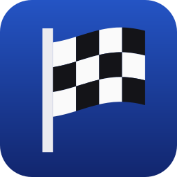

<p align="center"></p>

<h1 align="center">mkw-recomp</h1>

<p align="center">
  <b>Mario Kart World (Nintendo Switch 2) recompiled to run natively on Linux and Windows.</b>
</p>

<p align="center">
  <a href="https://github.com/adriadam10/mkw-recomp/releases/latest"></a>
  <a href="https://github.com/adriadam10/mkw-recomp/releases/latest"></a>
  <a href="https://github.com/adriadam10/mkw-recomp/releases/latest"></a>
</p>

<p align="center">
  <b><a href="https://github.com/adriadam10/mkw-recomp/releases">Releases</a></b> ·
  <b><a href="https://github.com/adriadam10/mkw-recomp/wiki">Help wiki</a></b> ·
  <b><a href="https://discord.gg/8uYBkjQkEg">Discord</a></b> ·
  <a href="CHANGELOG.md">Changelog</a> ·
  <a href="CONTRIBUTING.md">Contributing</a> ·
  <a href="docs/project/research.md#sources">Sources</a> ·
  <a href="docs/project/roadmap.md">Roadmap</a> ·
  <a href="docs/project/performance.md">Performance</a> ·
  <a href="https://github.com/adriadam10/mkw-recomp/issues">Issues</a> ·
  <a href="https://github.com/adriadam10/mkw-recomp/discussions">Discussions</a> ·
  <a href="https://archive.org/search?query=subject%3A%22mkw-recomp%22">Archive</a>
</p>

<!-- i18n-bar:start -->
<p align="center">
  <b>English</b> ·
  <a href="docs/i18n/README.zh-CN.md">简体中文</a> ·
  <a href="docs/i18n/README.es.md">Español</a> ·
  <a href="docs/i18n/README.ar.md">العربية</a> ·
  <a href="docs/i18n/README.hi.md">हिन्दी</a> ·
  <a href="docs/i18n/README.pt-BR.md">Português (Brasil)</a> ·
  <a href="docs/i18n/README.pt-PT.md">Português (Portugal)</a> ·
  <a href="docs/i18n/README.de.md">Deutsch</a>
</p>
<!-- i18n-bar:end -->

*Mario Kart World* (Switch 2, versions 1.0.0 and 1.8.0) turned into a native program for Linux and Windows. You need
your own copy of the game, dumped from your own console: nothing of the game is in this repository or its releases.

**It is a recompilation, not an emulator.** The game's AArch64 code is translated to C ahead of time and compiled for
your CPU (x86-64, or AArch64 on Linux); there is no CPU interpreter or JIT. The GPU is not emulated either: NVN2, the
Switch 2 graphics API, runs on top of Vulkan, and the game's shaders are translated to SPIR-V ahead of time.

## Status

Early, and moving fast (12/11/2026):

- It boots, plays the intro movies, goes through the menus and races, on Linux and Windows (x86-64) and on Linux
  AArch64 (its own AppImage, tested on an Adreno 740 handheld).
- The start screen sets the game up from your copy on your machine and holds every setting.
- Races run at 60 fps on high-end GPUs and at 30 on mid-range ones. Measured frame times per GPU:
  [docs/project/performance.md](docs/project/performance.md).
- Known problems: a few menus (mode, character and vehicle select) need work, the kart's shadow misses a frame now
  and then, some audio cuts during movies, and on some AMD drivers the GPU can hang. There is no online play.

## Roadmap

The open work, in order (details: [docs/project/roadmap.md](docs/project/roadmap.md)):

- **60 fps in races**: recording the game's frame for Vulkan is on the critical path, so it needs less CPU.
- **The picture as on the console**: the last shader bugs and the kart's shadow.
- **Every menu checked** against the console.
- **No GPU hangs**, less GPU memory, loading without stutter, a Linux package for non-rolling distributions.
- **1.8.0 on par with 1.0.0**: ultrawide, shadow map size, fixed seed ([#19](https://github.com/adriadam10/mkw-recomp/issues/19)).

## Playing

> **Stuck?** Search the [wiki](https://github.com/adriadam10/mkw-recomp/wiki) first: installation, settings, controls,
> [known errors by their log line](https://github.com/adriadam10/mkw-recomp/wiki/Troubleshooting) and a
> [FAQ](https://github.com/adriadam10/mkw-recomp/wiki/FAQ).


1. Dump Mario Kart World 1.0.0 or 1.8.0 from your Switch 2 (`exefs/` and `romfs/`, decrypted; 1.8.0 with the update
   merged into the base RomFS), or the same dump packed as one `.nup` or `.nx` file.
2. Download the launcher from [Releases](https://github.com/adriadam10/mkw-recomp/releases): the `.AppImage` on Linux
   (`-aarch64` on ARM; glibc 2.31 or newer: Debian 11, Ubuntu 20.04, SteamOS and later) or the `.zip` on Windows,
   unpacked into a folder. About 30 GB free.
3. Run it (`chmod +x` the AppImage first), open **Game files**, optionally **Choose game folder** (default on Linux:
   `~/.local/share/mkw-recomp`, or the folder you unpacked the AppImage into with `--appimage-extract`), point it at your
   dump and press **Set up**. The first setup takes a while: it compiles
   the whole game and downloads NVIDIA's `nvdisasm` and `ptxas` (84 MB on Linux, 126 MB on Windows). Then **Play**.
4. New releases are offered on the start screen (**Update to vX**); **Settings → Menu → Check for updates** turns that off.

With [RecompLauncher](https://github.com/elripalda/RecompLauncher), use **Easy Setup** and select your decrypted
`.nup`, `.nx` or the folder containing `exefs/` and `romfs/`. It builds the game in the game's `recompdata` folder in
your Recomp Library and uses the copy there to rebuild after updates. Allow about 30 GB free in that library.
RecompLauncher handles updates for this installation. The game, its settings and saves stay in that one folder whether
you use Easy Setup or set it up from the start screen, on Windows and on Linux (where the launcher unpacks the AppImage
into the library).

<a href="https://recomplauncher.com/game/mkw-recomp"></a>

Requirements: x86-64 CPU with AVX2 (or, on Linux, AArch64 with ARMv8.2: LSE, FP16, RCpc, DotProd, CRC32), a GPU with
Vulkan 1.3 (`VK_EXT_mesh_shader` recommended), 16 GB of RAM recommended. In a Docker or Podman container on Linux,
allow `userfaultfd` in the seccomp profile (Docker's default refuses it), or it runs several times slower.

To add your machine to the performance list, open a
[performance report](https://github.com/adriadam10/mkw-recomp/issues/new?template=performance.yml).

## Extra features

Beyond the console, all optional and off (or at the console's value) by default:

- **Display**: any internal resolution, 21:9 / 32:9 / 48:9, AMD FSR 1 scaling, HDR, VSync, mailbox or immediate presentation.
- **Frame generation**: frames made between the game's (30 fps shown at 60, or 240). Smoother, not faster; fast motion
  and the minimap can smear.
- **Frame rate**: 20 and 15 fps besides 60 and 30; Automatic drops to them when frames take too long, so a slow GPU
  keeps the race at real speed. **Low latency** (on by default) starts each frame as late as the GPU allows.
- **Graphics**: texture filtering and quality, detail distance, shadow quality.
- **Sound**: 5.1 surround.
- **Controls**: every key and button rebindable, mouse camera, Nintendo, Xbox or PlayStation icons, motion steering,
  vibration, local multiplayer with one controller each. Switch 2 controllers work over Bluetooth and, on Linux, USB
  (Windows USB: see below). Gyro from a Cemuhook / DSU server (DS4Windows, BetterJoy) is supported. Racing wheels
  work as a controller (steering and first buttons); for pedals, put a `gamecontrollerdb.txt` in the game folder.
- **Pause**: F5 pauses and resumes the game at any moment, as the console's HOME button does (picture and music stop
  where they are). While the game uses the network, as in a LAN race, it runs on out of focus and silent instead, as on
  the console.
- **Hacks**: turbo (F2), skip movies, unlock everything, fixed randomness, straight to time trial or free roam.
- **Languages**: menus in 20 languages; the game also in Catalan, Galician, Basque and Turkish.
- **Tools**: performance overlay and a one-click system info for bug reports.

### Switch 2 controllers over USB on Windows

They only start after a command sent to their second USB interface, which Windows leaves without a usable driver.
Once per controller, with [Zadig](https://zadig.akeo.ie/):

1. Plug the controller in and open Zadig.
2. **Options → List All Devices**, pick the controller's **Interface 1** (USB ID `057E` and `2069` Pro Controller,
   `2066`/`2067` right/left Joy-Con, `2073` GameCube). Not Interface 0: replacing it hides the controller from other apps.
3. Driver **WinUSB**, then **Replace Driver**.

The same applies to a virtual controller with those IDs (Switch2Connect's USB/IP mode). To undo it, uninstall that
interface's device in Device Manager with "delete the driver" ticked.

## Mods

The start screen's **Mods** page has two tabs:

- **Find on GameBanana**: Mario Kart World's mods on [GameBanana](https://gamebanana.com/games/22152), with author,
  license, screenshots and description. **Install** downloads only when you ask.
- **Installed**: each mod with an on/off switch; **Import zip / Import folder** takes a mod you already have (`.zip`,
  `.rar` or `.7z` with `romfs/`, `exefs/` and/or `plugin/` inside).

Mods that replace game files (`romfs/`) apply at the next start. Mods that patch the game's code (`exefs/` `.ips` or
`.pchtxt`, such as 200cc or 30 FPS) rebuild the game before you play (a few minutes). Two mods that change the same
file: the page asks which one wins. It also warns about mods that replace graphics settings or shaders.

A mod with a `plugin/` folder carries a native plugin (`.dll` or `.so`) that runs its own program on your computer:
turn it on only if you trust its source. For modders, the API is one header,
[`runtime/plugin/mkw_plugin.h`](runtime/plugin/mkw_plugin.h), explained in the wiki's
[Writing a plugin](https://github.com/adriadam10/mkw-recomp/wiki/Writing-a-plugin); more in the wiki's
[Mods](https://github.com/adriadam10/mkw-recomp/wiki/Mods) page.

Mods are made by others and not tested here: one can crash the game or damage your save. Keep a copy of your save,
report a mod's problems to its author, and when you report a bug here say which mods were on (the log lists them).

## Building from source

Linux, with `uv`, `clang`, `lld`, `ninja`, SDL3, Opus, libvpx, zstd, xxHash, the Vulkan headers and VMA 3.4.0 (details in
[tools/build/README.md](tools/build/README.md)). Put your dump in `game/` (`game/exefs`, `game/romfs`) or set
`MKW_GAME=<dir>`, then from the repo root:

```sh
uv run python recomp/gen.py --exefs game/exefs --jobs 8  # --out/--patches default to the dump's version (1.8.0: build/generated-180)
uv run tools/shaders/extract.py && uv run tools/shaders/translate.py
uv run tools/build/build.py              # build/mkw; --target windows builds mkw.exe with llvm-mingw (windeps.py)
build/mkw
```

Shortcuts: `make build`, `make appimage` (`make help` lists them all). On Windows itself, from a packed dump, or on
AArch64: see [tools/build/README.md](tools/build/README.md). Translating the shaders needs the SM86 encoding
specification, generated from NVIDIA's `nvdisasm` (not shipped): [tools/shaders/README.md](tools/shaders/README.md).
Everything generated goes to `build/`, never to git.

| Folder | Contents |
|---|---|
| [recomp/](recomp/README.md) | The generator: AArch64 → C |
| [runtime/](runtime/README.md) | What plays the console: kernel, memory, SDK replacements, NVN2 over Vulkan, audio, input, menus, launcher |
| [sm86/](sm86/README.md) | The shader translator: SM86 SASS → GLSL → SPIR-V |
| [i18n/](i18n/README.md) | Menu, start screen and setup texts in every language (gettext `.po`) |
| [tools/](tools/README.md) | Analysis, setup, build, game runs, diagnostics |
| [tests/](tests/README.md) | Tests without the game or a GPU, run in the CI on Linux and Windows |
| [docs/](docs/README.md) | Research, sources, performance |
| `.github/` | CI, issue and pull request templates |

At the root: `pyproject.toml` and `uv.lock` (the tools' Python environment), `.gitignore`, `.gitattributes`
(merge=union for the lists every PR appends to), `LICENSE`, `CONTRIBUTING.md`, `CHANGELOG.md`, `AGENTS.md` (guide for
coding agents) and `Makefile`.

## Design decisions (30/10/2026)

| Topic | Decision | Why |
|---|---|---|
| CPU | AArch64→C lifter based on [totk-pc-recomp](https://github.com/valentderah/totk-pc-recomp)'s (MIT), extended to ARMv8.1-8.3 (LSE atomics, CAS, LDAPR; PAC as identity, MTE tags as 0) | Same engine family, already scales to a large executable |
| System | The SDK's `nn::*` functions replaced by name, signatures from the mangled names of `main`'s 1 289 imports | No console services to emulate |
| Graphics | NVN2 over Vulkan: 529 of its 699 functions share their name with NVN1; 170 are new | Recompilation, not GPU emulation |
| Shaders | Our own SM86→SPIR-V translator, offline, with a decoder generated from the DocumentSASS / nvsass-disassembler specification | Covers mesh/task and what Maxwell lacks |
| Switch 2 extras | HDR automatic when the display is HDR (Settings > Screen > HDR); DLSS, ray tracing and touch off by default, their NVN2 functions exist but do nothing | Console hardware extras, not needed to play |
| Defaults | The console's look and resolution; lower settings are options | The player chooses |

## How it was made

Written with [Claude](https://claude.com/claude-code) (Anthropic's coding agent) doing most of the typing, under my
direction, in about ten days of full-time work (489 commits from 30/10/2026), each reviewed, measured or tested before
it went in.

- **Method more than prompts.** Performance changes are measured with an A/B inside the same run (two runs of the same
  build differ by up to 12 ms per frame); rendering fixes are checked against the console's own image; the shader
  translator is tested off the GPU on all 11 561 programs; frame captures replay the back end in seconds. Rules that
  came out of mistakes are written down and enforced by scripts.
- **Earlier work.** [totk-pc-recomp](https://github.com/valentderah/totk-pc-recomp) and its Linux port, my earlier
  recomps (SavageWindRecomp, smo-recomp), and maintaining [AnyPS5](https://github.com/boykopovar/AnyPS5) (faithful
  shader translation, mesh shaders as compute).
- **Community research.** [eden-nx2](https://git.eden-emu.dev/Takoroka/eden-nx2)'s Switch 2 notes, NVIDIA's SASS
  encoding as documented by DocumentSASS and nvsass-disassembler, Ryujinx and Mesa NAK for shader semantics, and the
  other Switch 2 ports in the sources.

## Licenses and credits

[MIT License](LICENSE). Code taken from other projects keeps its own license next to it (`LICENSE.*` files in
[recomp/](recomp/), [runtime/](runtime/), [sm86/decode/](sm86/decode/) and
[runtime/third_party/](runtime/third_party/README.md)): totk-pc-recomp, nvsass-disassembler, Dear ImGui, bc7enc,
stb_image, AMD FidelityFX FSR 1 and Roboto. Every source, with its license and what was taken (code from MIT projects
only; from GPL projects, ideas only): [docs/project/research.md](docs/project/research.md#sources).

This product uses **NVIDIA DLSS** (Super Resolution and Frame Generation, NVIDIA DLSS SDK, © NVIDIA Corporation),
**AMD FidelityFX Super Resolution 3.1** (© Advanced Micro Devices, MIT) and **RenHDrum** (MIT) for HD vibration. They
are not in the package: the settings download each one from its maker's release when you pick it. NVIDIA, NVIDIA RTX
and DLSS are trademarks of NVIDIA Corporation; this project is not sponsored or endorsed by NVIDIA or AMD. Their
notices and licenses are in the package's `licenses/` folder
([tools/build/THIRD_PARTY_NOTICES.txt](tools/build/THIRD_PARTY_NOTICES.txt)).

Mario Kart World is © Nintendo. This project is not affiliated with or endorsed by Nintendo, contains no game code or
assets, and does not help to obtain them.

Mods belong to their authors and their own licenses. This project is not affiliated with GameBanana or any mod's
author, does not host, review or distribute mods, and is not responsible for what a mod does: the start screen only
shows GameBanana's public listing and downloads a mod from there when you ask.

## Contributing

See [CONTRIBUTING.md](CONTRIBUTING.md). Bugs and performance reports go to
[Issues](https://github.com/adriadam10/mkw-recomp/issues), questions to
[Discussions](https://github.com/adriadam10/mkw-recomp/discussions).
